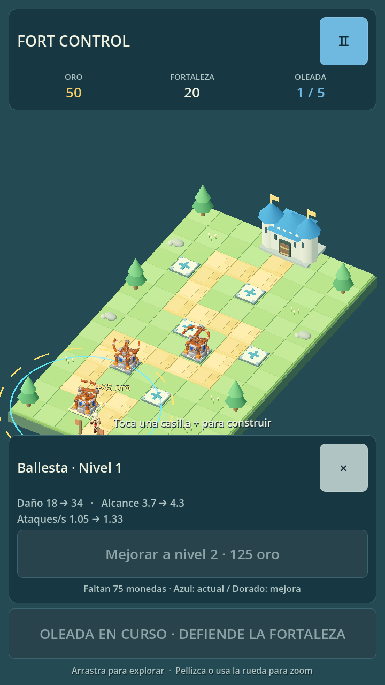

# Fort Control

Un Tower Defense 3D de fantasía medieval, hecho con **Godot 4 estándar y GDScript**. Construye ballestas en las casillas `+`, mejora tus defensas y protege la fortaleza durante cinco oleadas de esqueletos. El juego funciona sin internet, cuentas ni servicios externos.

Las pruebas automatizadas usan **Godot 4.6.3**. El MVP ya cuenta con una partida completa reportada en **iPhone 16 Pro con Godot 4.7.2**; esta actualización necesita una nueva prueba en el teléfono. Los resultados y las versiones utilizadas están en [validación](docs/validation.md).

## Qué incluye

- Un tablero de 8 × 14 casillas, camino fijo, castillo de piedra con techos azules y ocho posiciones de construcción.
- Ballestas que priorizan al enemigo más avanzado dentro de su alcance, con proyectiles visibles y tres niveles de mejora.
- Esqueletos con vida, movimiento por puntos del camino, recompensa por eliminación y daño al llegar al castillo.
- Modelos 3D texturizados de ballesta, esqueleto, espada y flecha, con animación de caminar y arma orientable.
- 300 monedas y 20 puntos de vida iniciales; cinco oleadas de dificultad creciente.
- Cámara isométrica ortográfica, selección, arrastre y zoom con mouse o pantalla táctil.
- Interfaz en español, pausa, victoria, derrota y reinicio.
- Efectos de combate, construcción y mejoras, sonidos locales y control de sonido desde pausa.
- Indicadores de alcance y comparación de estadísticas antes de mejorar una ballesta.
- Recursos de balance editables y pruebas automatizadas sin ventana.

Los modelos de combate están incluidos como archivos GLB en `assets/models/`. El tablero, el castillo y la decoración se crean con geometría nativa de Godot. No necesitas Blender, una cuenta de Meshy, plugins ni descargar paquetes de arte para jugar.



Captura con el renderizador Mobile en Linux. [Ver los modelos con la cámara acercada](docs/images/fort-control-models.png). La integración de los modelos todavía requiere una nueva partida en el iPhone para comprobar apariencia y rendimiento en el dispositivo.

## Jugar en una Mac con Apple Silicon

1. Usa **Godot Standard para macOS, Universal**, disponible en el [archivo oficial de versiones](https://godotengine.org/download/archive/). El recorrido de iPhone reportado por el usuario usa **4.7.2**; si ya tienes esa instalación funcionando, consérvala. Cloud mantiene **4.6.3** como referencia de pruebas. No necesitas la edición .NET.
2. Descomprime la descarga y arrastra **Godot.app** a **Aplicaciones**. Ábrela desde Finder. Si macOS pide confirmar la apertura, usa la opción que ofrece el sistema para esa aplicación; no desactives las comprobaciones de seguridad globales.
3. Abre **Terminal**. Si todavía no tienes Git, ejecuta `xcode-select --install` y termina la instalación de las herramientas de Apple.
4. Clona el proyecto y entra en su carpeta:

   ```bash
   git clone https://github.com/Dabot11/Fort_Control.git
   cd Fort_Control
   ```

5. En el administrador de proyectos de Godot, pulsa **Importar**, selecciona el archivo `project.godot` de esa carpeta y confirma **Importar y editar**.
6. Espera la primera importación. Pulsa **F5** o el botón triangular **Ejecutar proyecto**. Si el teclado usa F5 para otra función, pulsa **Fn + F5**.
7. Selecciona una casilla `+`, pulsa **Construir** y coloca tus primeras ballestas. Pulsa **Iniciar oleada** cuando estés preparado. Selecciona una torre para consultar sus estadísticas y mejorarla.

La escena principal es `scenes/main/main.tscn`. Para ejecutar únicamente esa escena abierta en el editor puedes usar **F6**; para una partida normal usa **F5**.

También puedes abrir o ejecutar el proyecto desde Terminal:

```bash
/Applications/Godot.app/Contents/MacOS/Godot --path . --editor
/Applications/Godot.app/Contents/MacOS/Godot --path .
```

El proyecto usa el renderizador **Mobile**. Si tu equipo presenta un problema de controlador gráfico, prueba **Compatibility** sin modificar la configuración del repositorio:

```bash
/Applications/Godot.app/Contents/MacOS/Godot --path . --rendering-method gl_compatibility
```

## Actualizar una copia que ya exporta a iPhone

Conserva los ajustes locales de `project.godot` y `export_presets.cfg`, incluidos tu Team ID y preset iOS. Esta actualización cambia el juego y mantiene esos dos archivos como estaban en el repositorio.

Desde la carpeta del proyecto:

```bash
git status --short
git pull --ff-only origin main
```

Si Git indica un conflicto con cambios locales, revisa los archivos afectados conservando tus ajustes. Después abre el proyecto con la misma versión de Godot que utilizaste para exportar y espera la importación de los nuevos GLB y sus texturas. Prueba con **F5**, vuelve a exportar para iOS y abre el proyecto Xcode recién generado. La exportación anterior no incorpora automáticamente los cambios del repositorio.

## Controles y reglas

| Acción | Mouse y teclado | Pantalla táctil |
| --- | --- | --- |
| Seleccionar casilla o torre | Clic corto | Toque corto |
| Mover cámara | Arrastrar con botón izquierdo | Arrastrar con un dedo |
| Acercar o alejar | Rueda del mouse | Pellizcar con dos dedos |
| Construir o mejorar | Botón del panel contextual | Botón del panel contextual |
| Iniciar siguiente oleada | Botón, Espacio o Enter | Botón inferior |
| Pausar o continuar | Botón, Escape o P | Botón de pausa |
| Activar o silenciar efectos de sonido | Control de sonido en pausa | Control de sonido en pausa |
| Reiniciar | Botón del menú | Botón del menú |

Arrastrar la cámara no construye una torre: la construcción siempre requiere confirmar en el panel. La siguiente oleada se habilita cuando termina la anterior. Puedes construir y mejorar durante una oleada si tienes oro. Las casillas del camino no permiten construir.

Al seleccionar una casilla vacía, el anillo **cian** muestra el alcance de una ballesta de nivel 1. En una torre construida, cian es el alcance actual y el anillo **dorado discontinuo** anticipa el siguiente nivel. El panel compara daño, alcance y ataques por segundo antes de gastar; nivel 3 es el máximo.

Los menús de pausa y resultado incluyen **Sonido: activado / desactivado**. La preferencia se conserva al reiniciar la partida durante la misma sesión, pero no se guarda al cerrar la aplicación. Los sonidos se generan localmente y no requieren internet ni archivos externos.

Cada esqueleto eliminado entrega 25 monedas una sola vez. Cada esqueleto que llega al final del camino resta una vida y no entrega monedas. Ganas al resolver los enemigos de las cinco oleadas con vida restante; pierdes cuando la vida llega a cero. Reiniciar comienza una partida limpia.

## Modificar el balance

Los parámetros están en archivos JSON de texto. Puedes editarlos desde Godot o cualquier editor. Después **detén la ejecución con F8 y vuelve a ejecutar con F5** para cargar los archivos modificados; el botón Reiniciar conserva los datos cargados al abrir el juego. Conserva comas, comillas y corchetes válidos; usa punto decimal, por ejemplo `1.25`.

| Archivo | Contenido |
| --- | --- |
| [`resources/balance/default.json`](resources/balance/default.json) | Oro inicial, vida del castillo, recompensas, daño al castillo, velocidad de proyectiles y estadísticas por nivel de torre |
| [`resources/waves/default.json`](resources/waves/default.json) | Cantidad, vida, velocidad e intervalo de aparición de cada oleada |
| [`resources/maps/meadow.json`](resources/maps/meadow.json) | Dimensiones, tamaño de casilla, camino, posiciones de construcción y castillo |

La referencia completa de campos y valores iniciales está en [`docs/balance.md`](docs/balance.md). No necesitas cambiar scripts para ajustar esos valores.

## Modelos 3D y animaciones

Los modelos aportados para Fort Control ya forman parte del proyecto. Godot los importa al abrirlo; las texturas están incluidas en los GLB y el juego funciona offline.

| Modelo | Recurso incluido | Uso |
| --- | --- | --- |
| Ballesta | `assets/models/tower/crossbow.glb` | Base fija y arma que apunta a los enemigos |
| Esqueleto | `assets/models/skeleton/warrior.glb` | Personaje animado que recorre el camino |
| Espada | `assets/models/sword/shardblade.glb` | Arma visual del esqueleto |
| Flecha | `assets/models/arrow/crystal_arrow.glb` | Proyectil de la ballesta |

La torre original se simplifica antes de incorporarla al juego. Los detalles de preparación, tamaños y procedencia están en [`assets/models/README.md`](assets/models/README.md). El mapa, el castillo y la vegetación conservan su geometría actual.

Los scripts `enemy_visual.gd` y `tower_visual.gd` adaptan los modelos a las reglas existentes. El esqueleto camina con su espada y conserva su barra de vida; la ballesta gira sobre una base fija y muestra sus tres niveles. El combate sigue usando el mismo recorrido, daño, alcance, cadencia y recompensas.

Para sustituir un modelo más adelante, cambia su capa visual y conserva los métodos documentados en [`docs/architecture.md`](docs/architecture.md). Comprueba escala, orientación, pivotes, animación y selección desde la cámara del juego. Evita editar `.godot/`: es una caché que Godot vuelve a generar.

## Ejecutar las pruebas

Desde la raíz del repositorio en macOS:

```bash
GODOT_BIN=/Applications/Godot.app/Contents/MacOS/Godot bash scripts/run_tests.sh
```

En Linux o si `godot` ya está en tu `PATH`:

```bash
bash scripts/run_tests.sh
```

El script importa el proyecto y ejecuta la suite sin ventana. Un error de importación o una prueba fallida produce un código de salida distinto de cero. Los resultados de una ejecución concreta y la cobertura manual pendiente se registran en [`docs/validation.md`](docs/validation.md).

Para ejecutar también tres simulaciones de balance —primera oleada con una ballesta, estrategia de referencia y estrategia alternativa sin fugas—:

```bash
bash scripts/run_tests.sh --gameplay
```

En macOS puedes anteponer `GODOT_BIN=/Applications/Godot.app/Contents/MacOS/Godot` al mismo comando.

Para comprobar solo la importación:

```bash
godot --headless --path . --editor --import --quit
```

Si usas el ejecutable de macOS sin alias, sustituye `godot` por `/Applications/Godot.app/Contents/MacOS/Godot`. La primera importación genera `.godot/`; esa caché no se versiona. Las pruebas headless verifican la lógica y la carga de escenas, pero no prueban el rendimiento gráfico ni los gestos en hardware móvil.

## Ejecutar en iPhone o iPad

Necesitas una Mac, **Xcode**, un dispositivo físico y la configuración de firma de tu propia cuenta de Apple. La preparación detallada está en [`docs/mobile-export.md`](docs/mobile-export.md).

1. Abre Xcode, acepta sus condiciones e instala los componentes que solicite. Añade tu cuenta en sus ajustes y conecta el iPhone por cable.
2. En Godot, abre **Editor → Administrar plantillas de exportación** e instala las plantillas que coincidan exactamente con **la versión del editor que estás usando**: 4.7.2 en el recorrido de iPhone ya probado por el usuario. Habilita **Import ETC2 ASTC** en los ajustes de compresión de texturas si el exportador lo solicita.
3. En **Proyecto → Exportar**, selecciona el preset **iOS** incluido. Configura tu **Team ID** y un **Bundle Identifier** propio, activa **Application → Export Project Only** y conserva la orientación vertical. En **Resources**, conserva el filtro `*.json`.
4. Exporta el proyecto Xcode a una carpeta local ignorada, por ejemplo `build/ios/`. Si la salida es `.zip`, descomprímela. Abre el archivo **`.xcodeproj`** generado.
5. En Xcode, selecciona tu **Personal Team**, firma automática y el **iPhone físico** conectado. Para este flujo usa **Apple Development** como identidad de firma en Debug y Release. Activa **Developer Mode** en el iPhone si lo solicita y ejecuta **Run**.
6. Revisa notch, zona segura inferior, selección, arrastre, pellizco, pausa y una partida completa. Usa la lista de [`docs/validation.md`](docs/validation.md).

Para probar en tu propio iPhone puedes usar una cuenta Apple gratuita con Personal Team; no necesitas la membresía pagada. La firma gratuita normalmente vence a los siete días y se renueva compilando e instalando otra vez desde Xcode. La guía explica cómo obtener el Team ID real desde `project.pbxproj`, sin publicar datos de firma. La nueva versión debe volver a comprobarse en el teléfono aunque el MVP base ya haya funcionado.

## Preparar Android

Instala **OpenJDK 17**, Android Studio y los componentes del SDK indicados en [`docs/mobile-export.md`](docs/mobile-export.md). Configura las rutas de Java y Android en los ajustes del editor de Godot, instala las plantillas que correspondan a ese editor, completa el identificador de aplicación del preset **Android** incluido, conserva `*.json` en el filtro de archivos de **Resources** y exporta un APK de depuración a `build/android/` para la primera prueba en un teléfono con depuración USB. Los requisitos de SDK documentados se refieren a Godot 4.6; revísalos si usas otra versión.

No necesitas permisos de internet para el juego. No guardes contraseñas de firma ni keystores dentro del repositorio. Una publicación en Google Play requiere preparar y firmar su propio AAB; no forma parte de esta entrega.

## Organización

| Carpeta o archivo | Responsabilidad |
| --- | --- |
| `project.godot` | Motor, escena inicial, ventana vertical y renderizador |
| `export_presets.cfg` | Preparación para macOS, Android, iOS y validación del paquete de recursos |
| `scenes/main/main.tscn` | Punto de entrada del juego |
| `scripts/core/` | Coordinación de la partida y estado general |
| `scripts/systems/` | Economía, vida y oleadas |
| `scripts/world/` | Tablero, casillas y escenario |
| `scripts/combat/` | Enemigos, torres, proyectiles y adaptación de sus modelos |
| `scripts/camera/` | Cámara ortográfica y gestos |
| `scripts/ui/` | HUD, selección y menús |
| `scripts/feedback/` | Respuesta visual y sonora a eventos de juego |
| `assets/models/` | Modelos GLB, texturas integradas y documentación de preparación |
| `resources/` | Configuración del mapa y balance |
| `tests/` | Verificaciones automatizadas |
| `docs/` | Balance, arquitectura, exportación y validación |

Consulta [`docs/architecture.md`](docs/architecture.md) para entender cómo se conectan los sistemas y [`AGENTS.md`](AGENTS.md) para las convenciones de futuras tareas.

## Limitaciones y próximos pasos

- Un mapa, un tipo de torre y un tipo de enemigo. No hay guardado de partidas, backend, anuncios ni compras.
- Los modelos de combate están integrados; el escenario mantiene su geometría procedural. El esqueleto camina y desaparece al morir o llegar al castillo; no se añade combate cuerpo a cuerpo.
- El balance incorpora la observación de que las primeras cuatro oleadas eran fáciles y la quinta concentraba el salto de dificultad. Necesita otra partida humana para comprobar el nuevo ritmo.
- La orientación móvil es vertical. La interfaz se adapta a otras proporciones de ventana, pero su experiencia principal es portrait.
- El MVP base ya tiene una partida completa reportada en iPhone 16 Pro. La nueva iteración, otros iPhone, iPad y Android necesitan validación; todavía no hay mediciones de consumo o rendimiento en teléfonos.

El siguiente paso es **repetir las cinco oleadas en el mismo iPhone 16 Pro** con los nuevos modelos: comprobar animaciones, orientación de disparo, legibilidad, controles y tiempos de fotograma cuando coincidan varios enemigos y proyectiles. Después conviene probar un Android de gama media. Los cambios de esta iteración están resumidos en [`docs/changelog.md`](docs/changelog.md).
